<h1 align="center">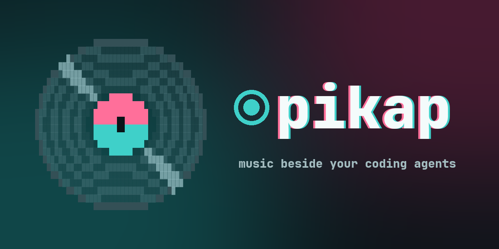</h1>

A Spotify remote for the terminal. pikap does not play audio itself: it drives
Spotify.app (or any Spotify Connect device) and gives the terminal the album art,
synced lyrics, an artist page with the whole discography, and a record that turns
while the music plays.

<p align="center">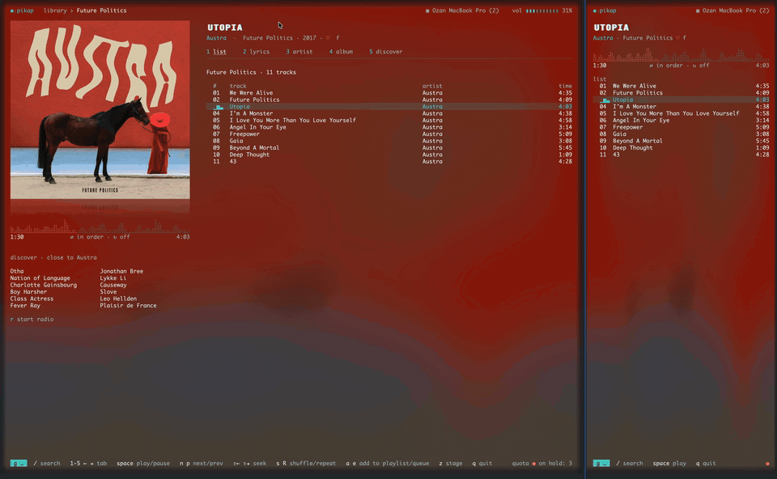</p>
<p align="center"><a href="docs/demo.mp4">Watch the demo in full resolution (70 s)</a></p>

*pikap* is Turkish for record player.

## Features

- **Now playing** with the real album cover, a blurred halo of it behind the whole
  screen, a glitch title and an equalizer that doubles as the progress bar, all in
  the cover's colours.
- **Synced lyrics** that follow the song, and a **stage mode** (`z`): the cover as a
  sleeve, the record slid out and turning, the current line karaoke style.
- **Artist pages**: popular tracks, the songs you liked, every album and single as a
  grid of covers, related artists.
- **Library**: Made For You (found by itself), liked songs, recently played, your
  playlists and saved albums. **Search** across tracks, albums, artists and playlists at once.
- **Playlists**: add the selected track to one of your playlists (`a`), remove it
  (`x`), add it to the queue (`e`).
- **Queue** (`g k`) and **devices** (`g d`): jump ahead in the queue, move playback
  to your phone or speaker.
- **Radio**: Spotify's own radio for the playing track or artist.
- A `g` key panel for getting around, a narrow layout for side panes, light and dark
  themes, English and Turkish.

## Beside your coding agents

The narrow layout fits a side pane, so the music sits next to your work: here beside
Codex and Claude Code,

<p align="center">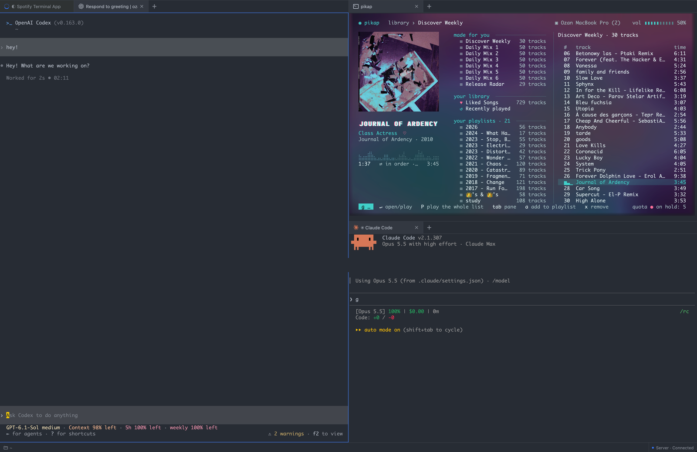</p>

or next to all of them at once (OpenCode, Claude Code, Codex, Antigravity):

<p align="center">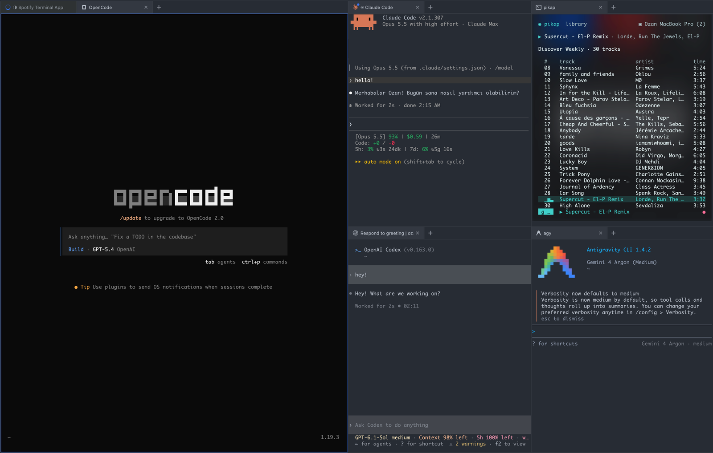</p>

The lyrics fit there too, scrolling with the song while an agent works:

<p align="center">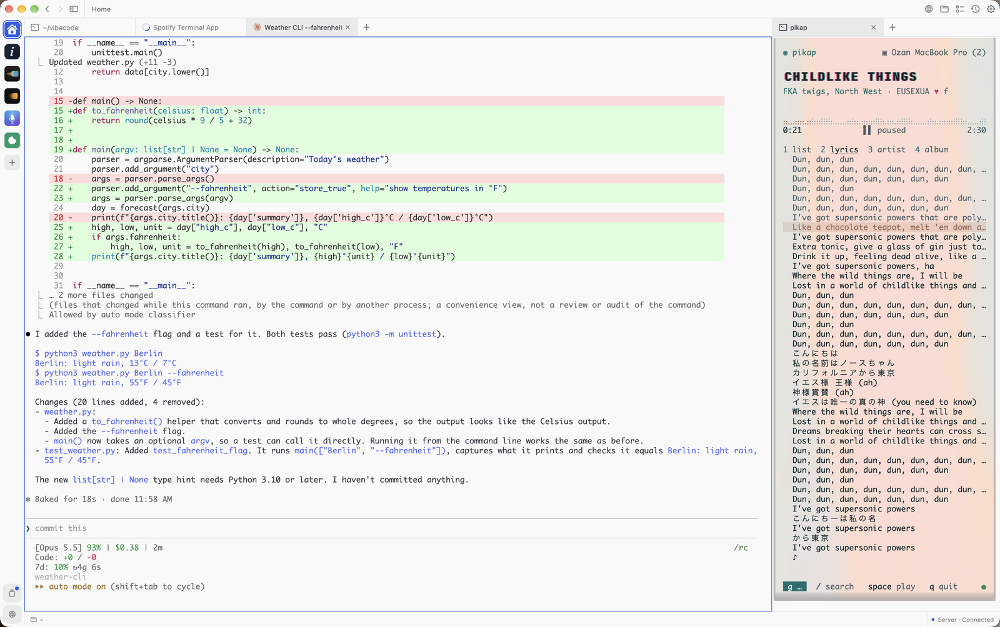</p>

| | |
|---|---|
| 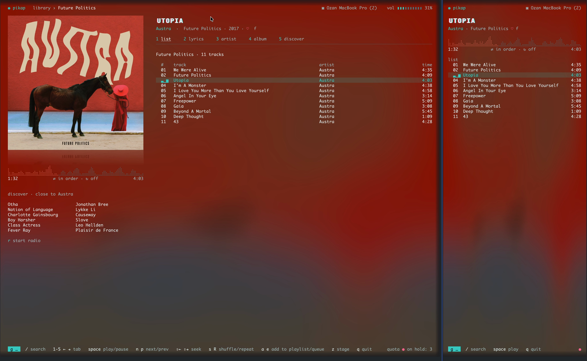 | 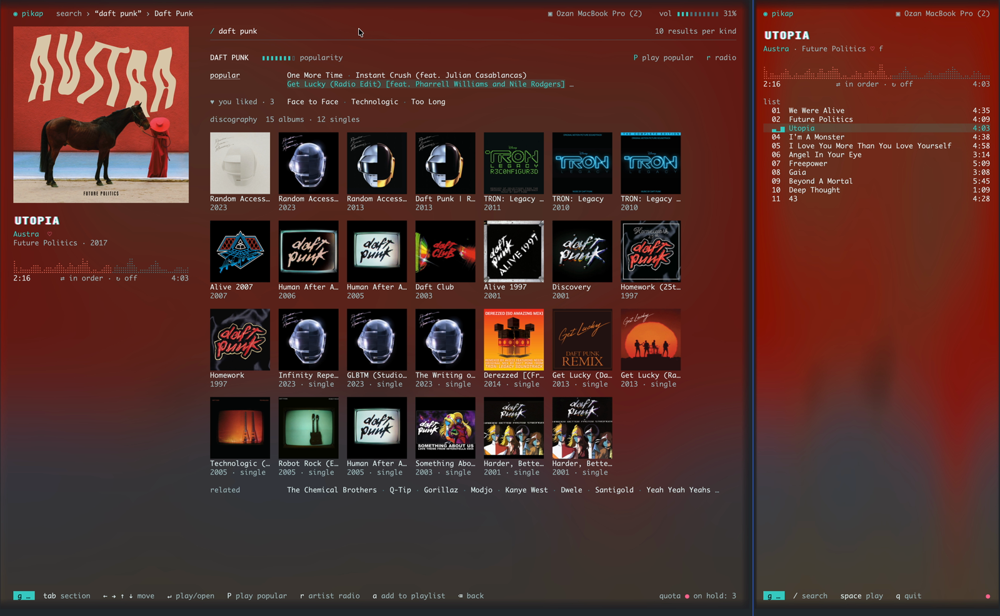 |
| 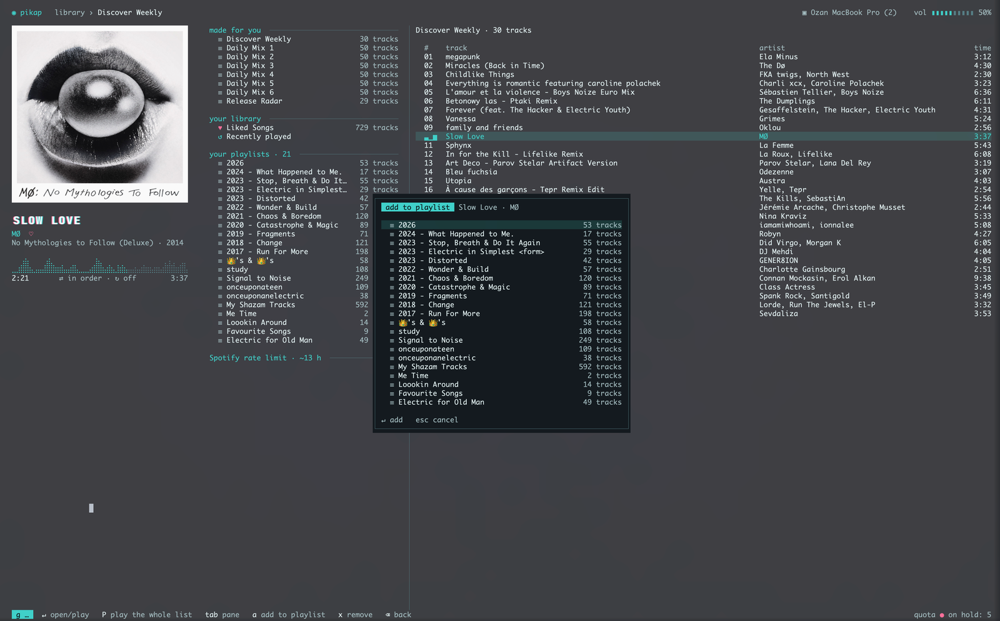 | 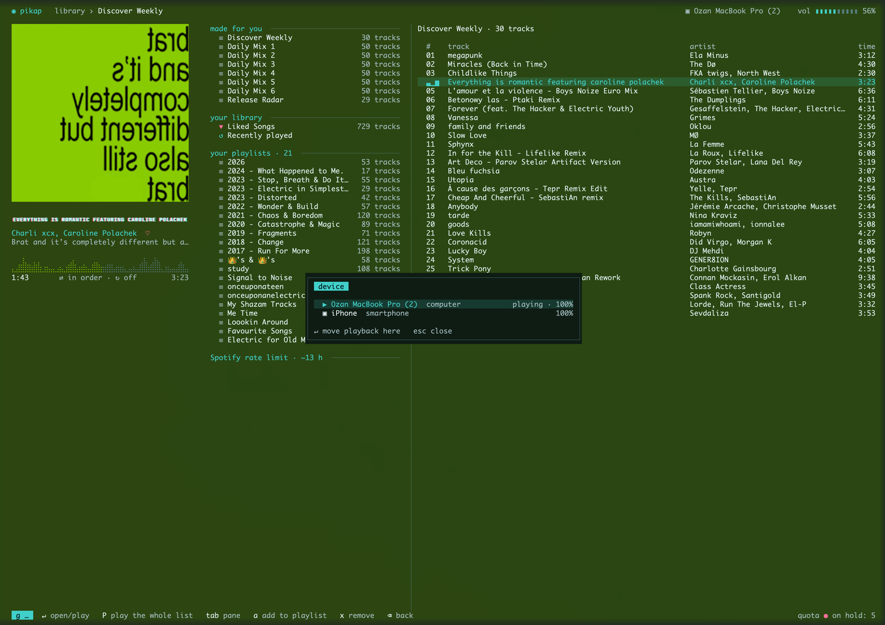 |
| 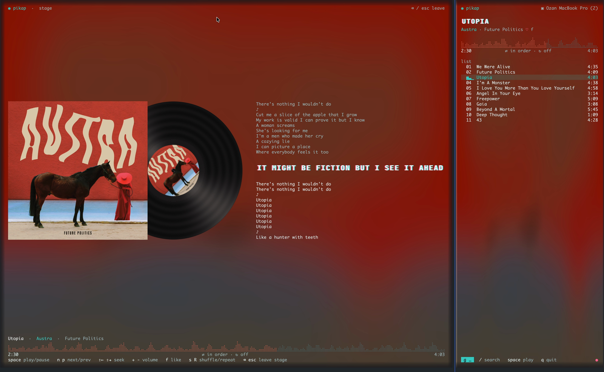 | 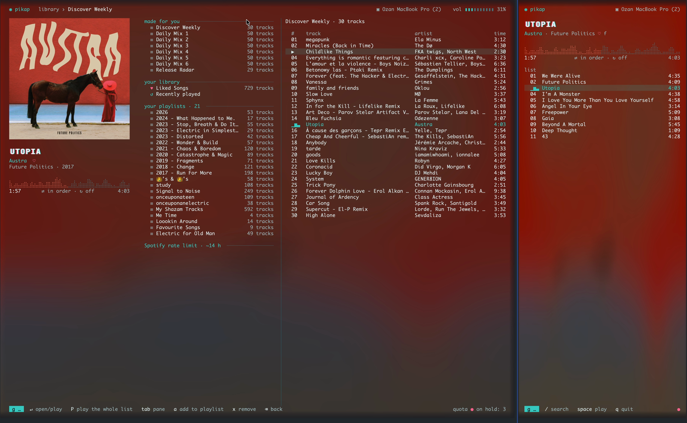 |

Every colour comes from the album cover that is playing.

## Requirements

- **macOS**. pikap talks to Spotify.app and the system (volume, focus) through macOS
  tools.
- A **terminal with kitty graphics** for the cover, the halo and the record: tested in
  Ghostty and Muxy; kitty and WezTerm speak the same protocol. Other terminals
  (Terminal.app, for example) get the same interface without the images.
  `pikap --check-terminal` tells which one you have.
- **Spotify Premium** (Spotify only allows remote control with Premium).

## Install

```sh
brew install ozangencer/tap/pikap
```

Or build it from source with Rust 1.88 or newer:
`cargo install --locked --git https://github.com/ozangencer/pikap pikap`.

## Set up Spotify

```sh
pikap auth
```

The first time, `pikap auth` opens the Spotify Developer Dashboard and walks you
through it. Spotify gives every user their own app (there is no shared key), so the
requests count against your own quota and nobody else's:

1. Create an app; any name and description. Under APIs, tick **Web API**.
2. Add this **Redirect URI** exactly: `http://127.0.0.1:8989/login`
3. In *Settings → User Management*, add the e-mail of your Spotify account (apps in
   Development Mode only work for listed users).
4. Paste the app's **Client ID** when `pikap auth` asks for it. It is saved to
   `~/.config/pikap/config.toml`.

Then the browser opens twice to sign in: once for the Web API (your app) and once
for Spotify's metadata service (artists, albums, radio, lyrics), which pikap reaches
through [librespot](https://github.com/librespot-org/librespot) the way other
librespot players do. Tokens are kept in `~/.cache/pikap/`, readable only by you.

Start Spotify.app (or have any Connect device online) and run `pikap`. With nothing
playing, `↵` resumes where you left off.

Your Made For You lists (Discover Weekly, Release Radar, Daily Mixes) appear in the
library on their own once you have played them: Spotify's Web API cannot list them, so
pikap recognises them among what you play. Nothing to set up. To add one you have
never played, you can paste its share link into `made_for_you` in the config
(optional, see [`config.example.toml`](config.example.toml)).

## Keys

| Key | |
|---|---|
| `space` | play / pause |
| `n` `p` | next / previous |
| `ö` `ç` or `⇧←` `⇧→` | seek 5 s back / forward |
| `+` `-` | volume |
| `f` | like |
| `s` `R` | shuffle / repeat |
| `1`–`5`, `←` `→` | home tabs: list, lyrics, artist, album, discover |
| `↑` `↓` / `j` `k` | move |
| `↵` | play or open |
| `P` | play the whole list |
| `a` `x` `e` | add to playlist / remove from it / add to queue |
| `r` | radio |
| `/` | search |
| `g` | key panel: `l` library, `s` search, `y` liked, `r` recent, `k` queue, `d` devices, `a` artist, `b` album, `L` lyrics, `z` stage |
| `z` | stage mode (`⌫` leaves) |
| `⌫` | back |
| `T` | light / dark theme |
| `ctrl-l` | redraw everything |
| `q` | quit |

`pikap --demo` shows a sample screen without Spotify; `--lang en|tr` and
`--theme dark|light` override the detected ones.

## Notes

- Development Mode apps get small daily quotas per endpoint. pikap keeps its
  requests low (a normal start makes about three), caches the library, liked songs
  and track details under `~/.cache/pikap/`, and shows on the status line when
  Spotify puts an endpoint on hold.
- Lists always play as a Spotify context (album, playlist, liked songs, Spotify's
  radio playlist). Starting playback from a plain list of tracks leaves current
  Spotify.app versions stuck with no track, so pikap never does.
- When Spotify plays on this Mac, the volume shown and changed is the system volume.
- A log of every request is kept in `~/.cache/pikap/pikap.log`.

## License

MIT. The bundled JetBrains Mono font is under the SIL Open Font License 1.1
(`crates/pikap/assets/OFL.txt`).
